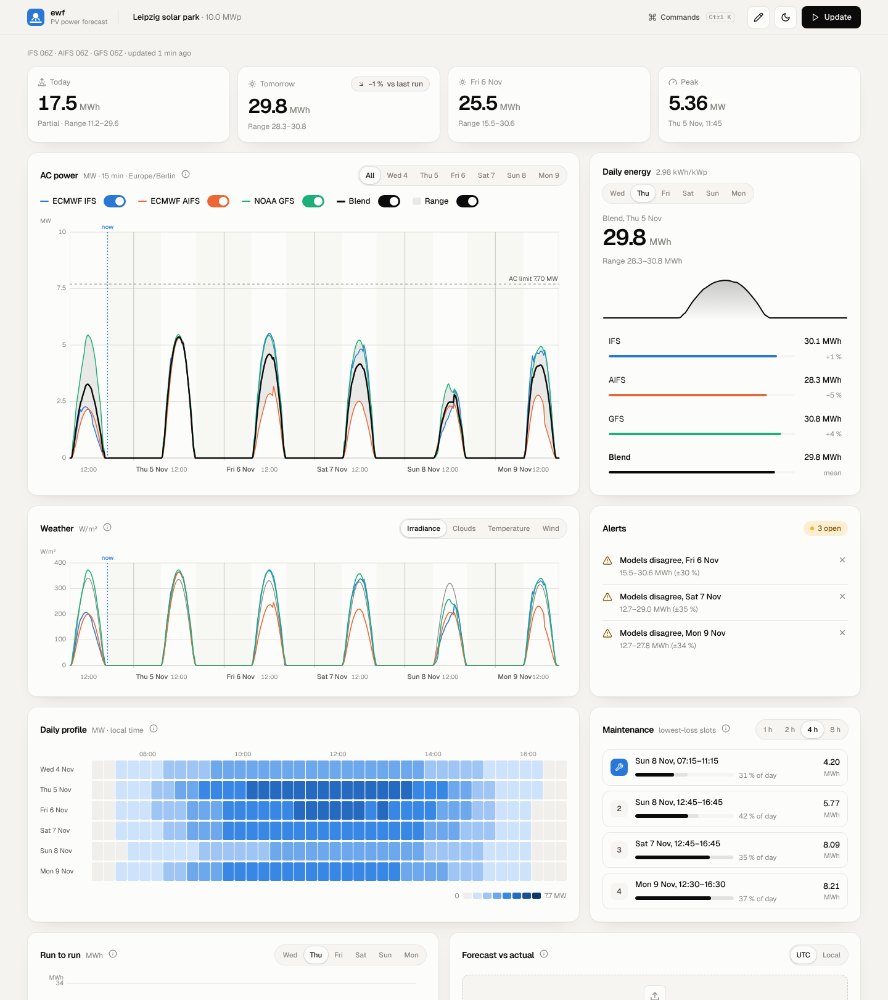

# energy-weather-forecasting

PV power forecasts from open weather-model data, and the research behind them.

- **`ewf`**: a forecasting tool. Describe a PV plant (location, size, orientation) and get a 15-minute AC power forecast for the next days from the latest ECMWF IFS, ECMWF AIFS and NOAA GFS runs, as CSV, JSON and an HTML report, on the command line or in a web dashboard.
- **Research**: papers with their data and code, see [`research/`](research/README.md).

## Forecast a PV plant

### Install

Python 3.10 or newer.

```bash
pip install -e ".[app]"
```

### Command line

```bash
ewf example-plant > plants/my-plant.yaml
```

Edit the file (location, kWp, inverter kW, tilt, azimuth or tracker), then:

```bash
ewf forecast --plant plants/my-plant.yaml
```

Or without a file:

```bash
ewf forecast --lat 51.42 --lon 12.24 --dc-kwp 10000 --ac-kw 7700 --tilt 20 --azimuth 180
```

The command prints energy per day and writes four files to `outputs/`:

| File | Content |
|---|---|
| `<plant>_<run>_15min.csv` | one row per 15 minutes (UTC period start, local time): power per model, blend, model range, irradiance, temperature, wind, cloud cover |
| `<plant>_<run>_daily.csv` | energy per local day per model and blend, kWh/kWp, whether the day is complete |
| `<plant>_<run>_summary.json` | plant, model runs used, daily energy, notes and data attribution |
| `<plant>_<run>_report.html` | self-contained report with charts and tables |

Useful options: `--hours 120` (horizon from now, up to about 240), `--models ifs,aifs` (choose models), `--out folder`, `--format csv,html`, `--no-cache`. A plant file may contain several plants under `plants:`; they are all computed from one download.

`ewf runs` shows which model runs are currently available.

### Web dashboard



Install the web extras, build the front end once (needs Node.js 20 or newer), and start the server:

```bash
pip install -e ".[web]"
```

```bash
cd web && npm install && npm run build && cd ..
```

```bash
ewf serve
```

Open http://127.0.0.1:8000. The plant is set up in a four-step wizard (location on a map, modules and orientation, inverter and limits, horizon and models) or loaded from a plant file; it is kept in the browser. `Ctrl K` opens the command palette.

| Part | What it shows |
|---|---|
| Headline tiles | Energy today, tomorrow and the day after (with the range between models), peak power; tomorrow's change against the previous model runs |
| AC power forecast | 15-minute power per model and the blend, the model range, the AC or export limit, clipped periods, night, "now"; day filter; models switch on and off |
| Energy per day | Total per day, scrubbable power curve, each model's energy and its difference to the blend |
| When the energy comes | Heat map of days by quarter-hours |
| Status | Events worth a look: models left out, old runs, days where models disagree by more than 35 %, clipping, jumps against the previous run |
| Maintenance windows | Daylight stops of 1, 2, 4 or 8 h that lose the least energy, with the worst case over models |
| Run-to-run changes | Energy for one day from each model run seen so far; "Load previous runs" fetches the runs before the latest |
| Weather | Irradiance per model against the clear sky, cloud cover, air and module temperature, wind |
| Forecast vs actuals | Drop a CSV of measured power: MAE, RMSE, bias and energy per model for the overlapping daylight periods |
| Model runs and downloads | Runs used, their age and source; CSV, JSON, HTML and zip downloads |

For front-end development run `ewf serve` and, in `web/`, `npm run dev` (port 5173, `/api` is proxied).

**UI kit.** `node scripts/build-kit.mjs` in `web/` copies the reusable parts (design tokens, UI components, the time-series chart and the heat map, helpers) to `web/dist-kit/pv-ui-kit/` with setup notes, for use in other React and Tailwind sites. Its `NOTICE.md` lists the files adapted from EasyUI (MIT).

**Snapshot page.** With `ewf serve` running, `node scripts/build-snapshot.mjs` in `web/` runs a fresh forecast for the example plant and writes `web/dist-snapshot/ewf-snapshot.html`: the whole dashboard in one file with that forecast embedded, for viewing where the server cannot run. It is clickable but cannot start new forecasts, load previous runs, compare measured data or download files; "now" and "today" refer to when it was made, and the map is replaced by coordinates.

The earlier Streamlit app still works as a simple alternative: `pip install -e ".[app]"` and `streamlit run app/streamlit_app.py`.

### From Python

```python
from ewf import Plant, run_forecast

plant = Plant(name="Leipzig", latitude=51.42, longitude=12.24,
              capacity_dc_kwp=10_000, capacity_ac_kw=7_700, tilt_deg=20, azimuth_deg=180)
result = run_forecast([plant], hours=72)
result.power("Leipzig")          # 15-minute kW per model, blend, min, max
result.daily_energy("Leipzig")   # kWh per local day
```

### How the forecast works

1. **Latest runs.** For each model the newest run that reaches the requested horizon is found on the public archives (Google Cloud mirrors first, then AWS and the providers' own servers).
2. **Only what is needed is downloaded.** For each time step the tool reads the GRIB2 index and downloads just five fields (solar radiation, 2 m temperature, 10 m wind components, cloud cover) with HTTP byte ranges, then interpolates them bilinearly to the plant. Results are cached in `~/.cache/ewf` (change with `EWF_CACHE_DIR`).
3. **Radiation conventions.** ECMWF accumulations and GFS window averages are converted to mean irradiance per model interval (see paper 01, Lemma 1).
4. **15 minutes.** Irradiance is interpolated through the clear-sky index, so the daily shape comes from solar geometry and the energy of every model interval is kept exactly; temperature, wind and cloud cover are interpolated linearly.
5. **PV physics (pvlib).** Erbs decomposition, Perez transposition (fixed tilt or single-axis tracking with backtracking), ASHRAE incidence-angle losses, Faiman cell temperature, PVWatts DC power, system losses, PVWatts inverter with clipping at the AC capacity, optional export limit.
6. **Blend.** The equal-weight mean of the models. The min-max band shows how much the models disagree; it is not a calibrated probability interval.

**Not modelled yet:** snow on modules, soiling events, outages, curtailment (Redispatch, negative prices), shading, bifacial gain. The model has not yet been calibrated against measured plant output; with a year of 15-minute plant data, a statistical correction and calibrated quantiles are the next step (paper 01, Sections 6 and 10).

### Data and licences

| Model | Source | Licence |
|---|---|---|
| ECMWF IFS, ECMWF AIFS Single | ECMWF open data | CC-BY-4.0, attribution "© ECMWF" (included in every output) |
| NOAA GFS | NOAA Open Data Dissemination | public domain |

All sources allow commercial use. The free Open-Meteo API (non-commercial only) is not used. The dashboard map loads tiles from OpenStreetMap (© OpenStreetMap contributors, ODbL; light use under the OSMF tile policy). Dashboard components are adapted from EasyUI (MIT), see [THIRD_PARTY_NOTICES.md](THIRD_PARTY_NOTICES.md).

### Tests

```bash
pytest -m "not network"
```

`pytest` without the marker also runs a live end-to-end test against the archives.

## Research

Research in this repository is published as papers in a common format, each with its data and code. See [`research/`](research/README.md).

| No. | Paper | |
|---|---|---|
| 01 | **Weather Forecasting for Renewable Energy**: requirements by technology, department and horizon, with evidence from three global models over Germany | [PDF](research/01-weather-forecasting-for-renewable-energy/weather-forecasting-for-renewable-energy.pdf) · [compendium](research/01-weather-forecasting-for-renewable-energy/) |

## Repository layout

```
energy-weather-forecasting/
├── README.md              this file
├── CLAUDE.md              conventions for research and code
├── CITATION.cff           how to cite
├── LICENSE                MIT
├── pyproject.toml         package definition (`pip install -e .`)
├── src/ewf/               the forecasting package
│   ├── plant.py           plant description, YAML/JSON loading
│   ├── weather/           model archives, run selection, GRIB download and interpolation
│   ├── resample.py        model steps to 15-minute periods
│   ├── pv.py              PV physics (pvlib chain)
│   ├── forecast.py        orchestration, blend, daily energy
│   ├── insights.py        maintenance windows, clipping
│   ├── verify.py          forecast vs measured power
│   ├── history.py         log of past runs (run-to-run changes)
│   ├── report.py          CSV, JSON and HTML outputs
│   ├── api.py             HTTP API for the dashboard (FastAPI)
│   └── cli.py             `ewf` command (`forecast`, `runs`, `serve`)
├── web/                   dashboard (React, TypeScript, Tailwind, framer-motion)
├── design/reference/      EasyUI component code collected as reference
├── docs/img/              screenshots
├── THIRD_PARTY_NOTICES.md licences of reused code
├── app/streamlit_app.py   simple Streamlit app
├── .streamlit/            app theme in the house palette
├── plants/                example plant files
├── tests/                 unit tests and one live test
└── research/              papers, style guide and LaTeX template
```
